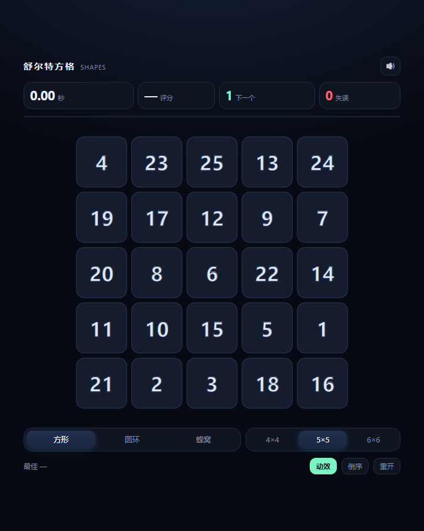
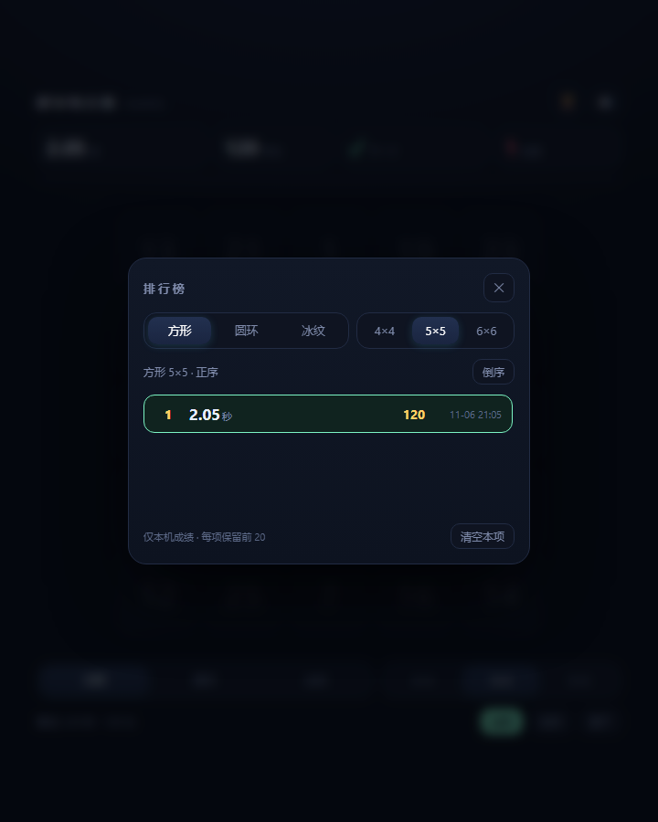
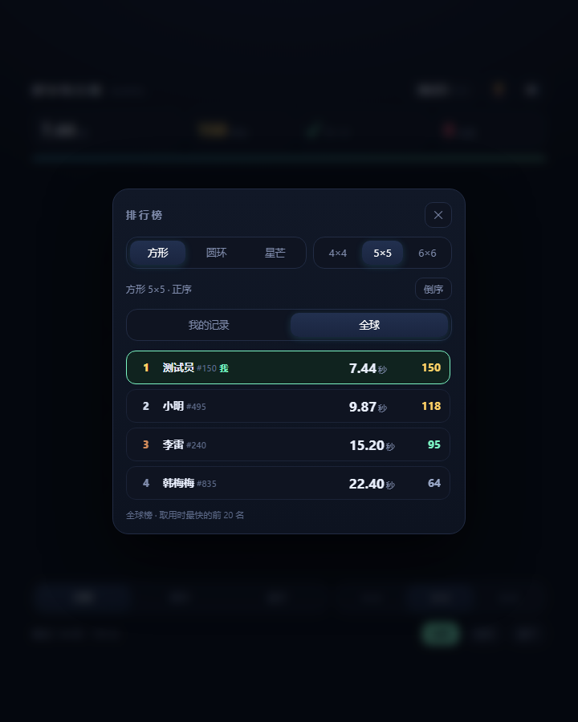
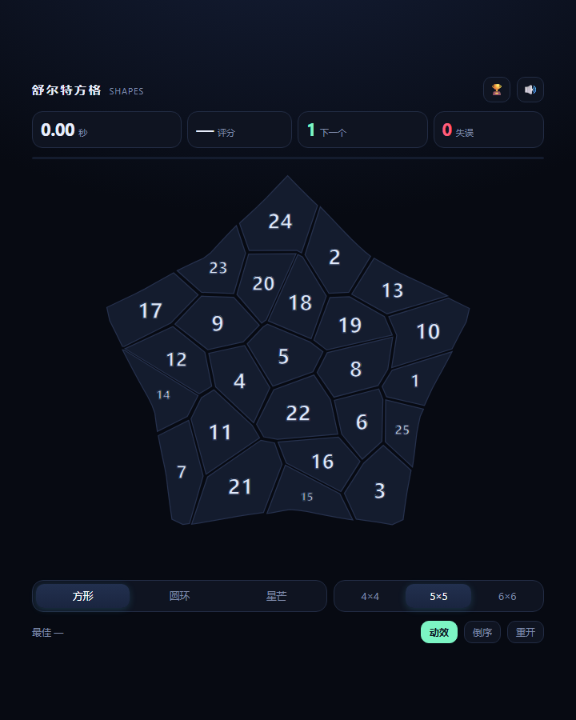

# 舒尔特方格 · 形状挑战

一个单文件、零依赖的舒尔特方格（Schulte Grid）小游戏。点击 1→N 按顺序找数字，三种棋盘形状、实时评分、圆环模式下每一圈会独立转动。

在线游玩：**https://fishquito.site**



## 玩法

- 从数字 **1** 开始，按顺序点击，直到点完最后一个数字。
- 点错一次 **+1 秒罚时**，并计入失误次数。
- 3-2-1 倒计时结束后计时开始，点完最后一格停表。
- 成绩按「形状 × 尺寸 × 正序/倒序」分别记录最佳（`localStorage`）。

## 三种棋盘

| 模式 | 说明 |
|---|---|
| **方形** | 标准舒尔特方格，行列有对齐线索，最省力 |
| **圆环** | 同心环 + 扇区。半径按 `r_k = R·√(累计格数/总格数)` 分布，保证每格面积相等；每一圈以不同角速度、不同方向缓慢自转，数字始终保持竖直 |
| **星芒** | 五角星轮廓 + Voronoi 碎块。先在单位圆里生成 Voronoi（圆是凸的，半平面裁剪才成立），再按角度把半径映射到星形边界；连续映射保证格子不会被切断。轮廓带凹角，视线没法一次扫完，难度最高 |

圆环的每一圈转速：`[中心 0°, 内环 +6°/s, 中环 −4.2°/s, 外环 +3.1°/s]`。右下角「动效」开关可关闭转动——关闭后成绩与静态模式可比。

## 排行榜

点右上角 🏆 打开。按「形状 × 尺寸 × 正序/倒序」共 18 个榜单。

- **我的记录**：本机日志，保存最近 20 次，按时间倒序，★ 标出个人最好。存在 `localStorage`（键 `schulte.lb.v3`）。
- **全球榜**：按用时升序，**每人每榜只有一条**，只记个人最好成绩；自己那行会高亮并标「我」。

**全球榜（可选）**：自带一个零依赖 Node 后端，放自己的服务器上即可，不用数据库。

```bash
cd server
node server.js          # 默认 http://127.0.0.1:8090，同时把游戏本体也托管了
```

打开 `http://127.0.0.1:8090/` 就能直接玩，前后端同源，**不需要任何配置**。
部署到正式服务器（systemd / nginx / HTTPS / 环境变量）见 [`server/README.md`](server/README.md)。

站点由这台 Node 服务直接托管（`fishquito.site` → nginx → `127.0.0.1:8090`），
前后端同源，所以前端**不需要填任何地址**，页面会自动探测 `/api/health`。

如果哪天要把前端挪到别处（对象存储、别的域名），再把后端地址填进 `index.html` 顶部：

```js
const NET = Object.assign({
  base: 'https://api.example.com'   // ← 后端地址，留空则自动探测同源
}, window.SCHULTE_NET || {});
```

留空且探测不到后端时，界面上不会出现「全球」页签，完全退回本机模式。

### 档案（昵称 + 档案号）

第一次打开会请你起个名字，同时服务端生成一个 **9 位档案号**（前 3 位数字 + 后 6 位字母数字，去掉了 `0/1/I/L/O/U` 这类易混字符），例如 `495MNTTE7`。

- **昵称**只是显示名，**允许重名**；榜单上显示为 `小明#495`——昵称高亮，`#` 后面的三位是档案号前缀，灰色小字，用来区分同名的人。
- **档案号**是唯一的钥匙，也是跨设备的凭证。点右上角的昵称打开「我的档案」，可以复制档案号或**同步链接**：`https://你的站点/?id=495MNTTE7`，在手机上打开就自动接管同一份档案。
- 结算时自动和你自己的最好成绩比较：破了记录就直接覆盖你在榜上的那一行，不需要点任何按钮；没破则榜单不变。
- 清缓存或换浏览器会被当成新用户；档案号丢了只能重新建档（这就是不设密码的代价）。

> 同步链接用的是「线上站点」地址：在 `index.html` 里有个常量 `PUBLIC_BASE = 'https://fishquito.site'`，
> 本机（`127.0.0.1` / `file://`）调试时会自动用它生成链接，避免把回环地址发出去。换域名只改这一处。






## 星芒模式



## 评分

```
评分 = 基准时间 ÷ 用时 × 100     （上限 150）
```

| 等级 | 条件 |
|---|---|
| S | ≥ 100（达到或快于基准线） |
| A | ≥ 80 |
| B | ≥ 65 |
| C | ≥ 50 |
| D | < 50 |

S 级基准时间（秒）：

| | 4×4 | 5×5 | 6×6 |
|---|---|---|---|
| 方形 | 9 | **15** | 23 |
| 星芒 | 11 | 18 | 27 |
| 圆环 | 12 | 19 | 29 |

换算方式：每格约 0.6 秒（4×4 略快、6×6 略慢），星芒 ×1.2，圆环（自转）×1.27。
所以 5×5 方形 **15 秒以内才是 S**，30 秒只是 C，超过 30 秒就是 D。

圆环基准高于方形约 27%，因为转动本身提高了搜索代价；星芒没有对齐线索、轮廓还有凹角，比方形高约 20%。三种模式的成绩不能直接比时间，各自跟各自的基准线比。

## 运行

直接双击 `index.html`，或：

```bash
# 任选其一
python -m http.server 8000
npx serve .
```

## 许可

MIT
