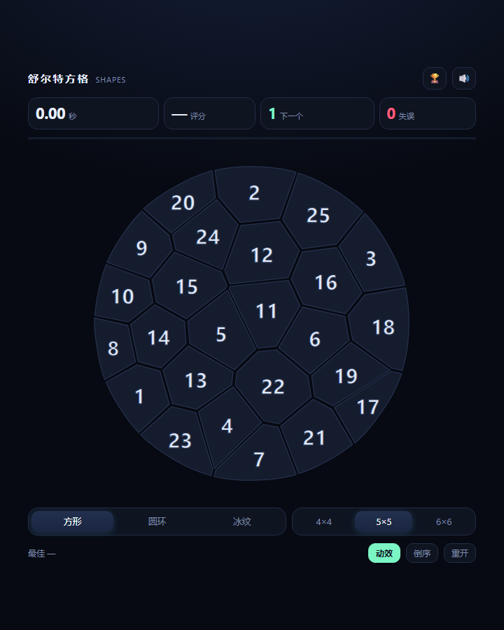

# 舒尔特方格 · 形状挑战

一个单文件、零依赖的舒尔特方格（Schulte Grid）小游戏。点击 1→N 按顺序找数字，三种棋盘形状、实时评分、圆环模式下每一圈会独立转动。

在线试玩：**https://fishquito.github.io/schulte-game/**


## 玩法

- 从数字 **1** 开始，按顺序点击，直到点完最后一个数字。
- 点错一次 **+1 秒罚时**，并计入失误次数。
- 3-2-1 倒计时结束后计时开始，点完最后一格停表。
- 成绩按「形状 × 尺寸 × 正序/倒序」分别记录最佳（`localStorage`）。

## 三种棋盘

| 模式 | 说明 |
|---|---|
| **方形** | 标准舒尔特方格，行列有对齐线索，最省力 |
| **圆环** | 同心环 + 扇区。半径按 `r_k = R·√(累计格数/总格数)` 分布，保证每格面积相等；每一圈以不同角速度、不同方向缓慢自转，数字始终保持竖直 |
| **冰纹** | Voronoi 碎石：最远点采样撒种子 + 两轮 Lloyd 松弛，让每块多边形面积接近；棋盘上**没有任何行列或环向线索**，只能靠形状记忆定位 |

圆环的每一圈转速：`[中心 0°, 内环 +6°/s, 中环 −4.2°/s, 外环 +3.1°/s]`。右下角「动效」开关可关闭转动——关闭后成绩与静态模式可比。

## 排行榜

点右上角 🏆 打开。

- 按「形状 × 尺寸 × 正序/倒序」共 18 个榜单，每项保留前 **20** 名，按用时升序排列；
- 显示名次、用时、评分、日期，刚打完的那一局会高亮；
- 数据存在浏览器 `localStorage`（键 `schulte.lb.v1`），**仅统计本机成绩**，换设备/清缓存即消失。

> 纯静态站点想做真正的全球榜需要一个后端。最小改法：Supabase 建一张 `scores` 表 + RLS，把 `lbPush / lbList` 换成两个 `fetch`，其余界面不用动。


## 冰纹模式



## 评分

```
评分 = 基准时间 ÷ 用时 × 100     （上限 120）
```

| 等级 | 条件 |
|---|---|
| S | ≥ 100（达到或快于基准） |
| A | ≥ 85 |
| B | ≥ 70 |
| C | ≥ 55 |
| D | < 55 |

S 级基准时间（秒）：

| | 4×4 | 5×5 | 6×6 |
|---|---|---|---|
| 方形 | 18 | 30 | 48 |
| 圆环 | 22 | 38 | 58 |
| 冰纹 | 21 | 35 | 55 |

圆环基准高于方形约 27%，因为转动本身提高了搜索代价；冰纹没有对齐线索、格子形状不规则，也比方形高约 17%。三种模式的成绩不能直接比时间。

## 运行

直接双击 `index.html`，或：

```bash
# 任选其一
python -m http.server 8000
npx serve .
```

## 许可

MIT
